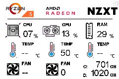
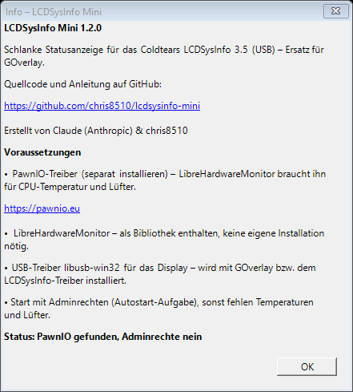

# LCDSysInfo Mini

*[English version](README.md)*

Schlanke Statusanzeige für das **Coldtears LCDSysInfo 3.5** (USB-Display 480×320, `VID 20A0 / PID 41ED`)
– ein Ersatz für **GOverlay** ohne AIDA64.



- Zeichnet deine **GOverlay-Vorlage** (`*.gov`) unverändert: Hintergrund, Icons, Texte, Rechtecke, Sensorwerte.
- Sensorwerte kommen aus **LibreHardwareMonitor** (CPU/GPU-Last und -Temperatur, RAM, Lüfter, SSD-Temperatur)
  und aus Windows (freier Speicher). AIDA64 wird nicht gebraucht.
- Das Display rendert selbst. Icons und Schriften liegen schon in seinem Speicher, die App schickt nur kleine
  USB-Befehle und zeichnet nur, was sich geändert hat.
- Ein Prozess, ca. 1 % eines CPU-Kerns und knapp 70 MB Arbeitsspeicher (gemessen auf einem Ryzen 7 5800X).
- Symbol im Infobereich mit Menü: *Neu zeichnen*, *Vorlage wählen …*, *Log öffnen*, *Info …*, *Beenden*.
  Die App ist auf Deutsch, wenn Windows auf Deutsch eingestellt ist, sonst auf Englisch.



## Voraussetzungen

| | |
|---|---|
| Windows 10/11 x64 mit .NET Framework 4.8 | ist bei aktuellem Windows dabei |
| USB-Treiber **libusb-win32** für das Display | wird mit GOverlay bzw. dem LCDSysInfo-Treiber installiert |
| **[PawnIO](https://pawnio.eu)** | separat installieren; LibreHardwareMonitor braucht den Treiber für CPU-Temperatur und Lüfter |
| Adminrechte beim Start | übernimmt die Autostart-Aufgabe (siehe unten) |

LibreHardwareMonitor selbst muss **nicht** installiert werden, die Bibliothek wird mitgeliefert.
Die Icons und Schriften, die eine Vorlage verwendet, müssen auf dem Display liegen (das ist der Fall, wenn
GOverlay die Vorlage schon einmal angezeigt hat).

## Installation

**Download:** `LCDSysInfoMini-<version>.zip` unter [Releases](https://github.com/chris8510/lcdsysinfo-mini/releases)
herunterladen, in einen dauerhaften Ordner entpacken und weiter bei *Autostart*.

**Oder selbst bauen:**

```bat
git clone https://github.com/chris8510/lcdsysinfo-mini.git
cd lcdsysinfo-mini\app
build.cmd
```

`build.cmd` lädt beim ersten Mal LibreHardwareMonitorLib 0.9.6 samt Abhängigkeiten von nuget.org
(`tools\fetch-lhm.ps1`, feste Versionen) und kompiliert die App mit dem C#-Compiler, der in Windows enthalten ist.
Ergebnis: `app\LCDSysInfoMini\LCDSysInfoMini.exe`.

**Autostart:** `install_task.ps1` (in `app\` bzw. im Hauptordner der Release-ZIP) als Administrator ausführen. Das Skript
- legt die geplante Aufgabe `lcdsysinfo-mini` an (bei Anmeldung, mit Adminrechten) und startet sie,
- sichert GOverlays Autostart-Aufgabe nach `backup_GOverlay_Autostart.xml` und deaktiviert sie.

Ein Eintrag im Autostart-Ordner reicht nicht: Programme dort dürfen nicht mit Adminrechten starten.

Beim ersten Start fragt die App nach der Vorlage (`*.gov`, meist im GOverlay-Ordner). Die Wahl wird in
`LCDSysInfoMini.ini` gespeichert.

**Zurück zu GOverlay:** App über das Menü beenden, Aufgabe `lcdsysinfo-mini` in der Aufgabenplanung
deaktivieren, `GOverlay Autostart` wieder aktivieren.

## Wie Sensoren zugeordnet werden

GOverlay-Vorlagen nennen AIDA64- oder OpenHardwareMonitor-Sensoren. Die App ordnet sie LibreHardwareMonitor zu
(`app/src/Sensors.cs`):

| Vorlage | LibreHardwareMonitor |
|---|---|
| `[OHMD:/amdcpu/0/load/0]` | CPU-Last gesamt |
| `[AIDA:Value.SMEMUTI]` | RAM-Auslastung |
| `[AIDA:Value.DGPU1]` | GPU-Last (bei AIDA64 eigentlich GPU-Lüfter in %, wird in Vorlagen aber meist als „GPU %“ beschriftet) |
| `[AIDA:Value.TCPU]` / `TGPU1` | CPU- bzw. GPU-Temperatur |
| `[AIDA:Value.FCPU]` / `FGPU1` | CPU-Lüfter (Mainboard-Chip) bzw. GPU-Lüfter |
| `[AIDA:Value.THDDn]` | Temperatur des n-ten Laufwerks (AIDA zählt ab 1, Windows ab 0) |
| `[AIDA:Value.SDRVxFREESPC]` | freier Speicher auf Laufwerk x: in GB |

Nach dem ersten Durchlauf wird nur noch die Hardware abgefragt, die die Vorlage braucht. Laufwerke werden alle
10 s, Mainboard-Sensoren alle 5 s gelesen. Die vollständige Sensorliste schreibt die App nach `sensors.txt`.

Nur angenähert umgesetzt: `maxdigits`, `font_fixedspacing` und Farbschwellen (`t1_*`) aus GOverlay-Vorlagen.

## Protokoll

Das USB-Protokoll wurde aus GOverlay 1.4.3 rekonstruiert, ausschließlich durch statische Analyse und lesende
Tests am Gerät. Details stehen in [docs/PROTOCOL.de.md](docs/PROTOCOL.de.md). Alle Befehle sind Vendor-Control-Transfers
auf Endpoint 0. Die App benutzt nur Zeichen- und Lesebefehle. Befehle, die Flash, EEPROM oder Firmware verändern
(14, 15, 16, 28), sind bewusst nicht implementiert.

## Python-Prototyp

Im Hauptordner liegt der Python-Prototyp, aus dem die App entstanden ist (`lcd.py`, `govtemplate.py`,
`sensormap.py`, `sensors_lhm.py`, `lcdmini.py`). Er braucht Python 3.12 mit `pyusb`, `psutil` und `pythonnet`:

```bat
python -m venv .venv
.venv\Scripts\pip install pyusb psutil pythonnet
powershell -ExecutionPolicy Bypass -File tools\fetch-lhm.ps1
.venv\Scripts\python lcdmini.py info          &rem nur lesen: Seriennummer, Firmware, Dateitabelle
.venv\Scripts\python lcdmini.py gov  "C:\Pfad\zur\Vorlage.gov"
.venv\Scripts\python test_offline.py          &rem Paketkodierung ohne Gerät prüfen
.venv\Scripts\python screenshot.py bild.png 2 &rem Display zurücklesen (halbe Auflösung, ca. 3 min)
```

`measure_cpu.ps1` misst den CPU-Verbrauch der laufenden App über die CPU-Zyklen.

## Mitwirkende

Erstellt von **Claude** (Anthropic) und **[chris8510](https://github.com/chris8510)**.

Kein offizielles Produkt von Coldtears Electronics oder GOverlay. Benutzung auf eigene Verantwortung.

## Lizenz

Eigener Code: [MIT](LICENSE). Mitgenutzte Bibliotheken behalten ihre Lizenzen, siehe
[THIRD-PARTY-NOTICES.md](THIRD-PARTY-NOTICES.md).
