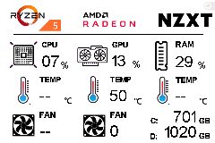
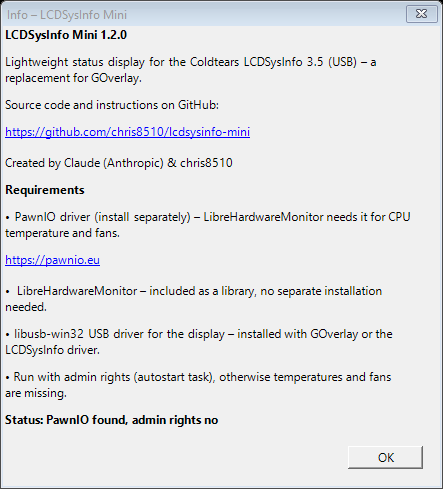

# LCDSysInfo Mini

*[Deutsche Fassung](README.de.md)*

Lightweight status display for the **Coldtears LCDSysInfo 3.5** (USB display 480×320, `VID 20A0 / PID 41ED`)
– a replacement for **GOverlay** that does not need AIDA64.



- Draws your **GOverlay template** (`*.gov`) as is: background, icons, texts, rectangles, sensor values.
- Sensor values come from **LibreHardwareMonitor** (CPU/GPU load and temperature, RAM, fans, SSD temperature)
  and from Windows (free disk space). AIDA64 is not needed.
- The display renders by itself: icons and fonts are already stored in its memory, the app only sends small USB
  commands and redraws only what changed.
- One process, about 1 % of one CPU core and just under 70 MB of memory (measured on a Ryzen 7 5800X).
- Tray icon with menu: *Redraw*, *Choose template …*, *Open log*, *Info …*, *Exit*.
  The app is in English, or in German when Windows is set to German.



## Requirements

| | |
|---|---|
| Windows 10/11 x64 with .NET Framework 4.8 | included in current Windows |
| **libusb-win32** USB driver for the display | installed with GOverlay or the LCDSysInfo driver |
| **[PawnIO](https://pawnio.eu)** | install separately; LibreHardwareMonitor needs this driver for CPU temperature and fans |
| Admin rights at start | handled by the autostart task (see below) |

LibreHardwareMonitor itself does **not** need to be installed; the library ships with the app.
The icons and fonts a template uses must be on the display (they are if GOverlay has shown the template before).

## Installation

**Download:** take `LCDSysInfoMini-<version>.zip` from [Releases](https://github.com/chris8510/lcdsysinfo-mini/releases),
extract it to a permanent folder and continue with *Autostart*.

**Or build it yourself:**

```bat
git clone https://github.com/chris8510/lcdsysinfo-mini.git
cd lcdsysinfo-mini\app
build.cmd
```

On first run `build.cmd` downloads LibreHardwareMonitorLib 0.9.6 and its dependencies from nuget.org
(`tools\fetch-lhm.ps1`, pinned versions) and compiles the app with the C# compiler that ships with Windows.
Result: `app\LCDSysInfoMini\LCDSysInfoMini.exe`.

**Autostart:** run `install_task.ps1` (in `app\`, or in the root of the release ZIP) as administrator. It
- creates the scheduled task `lcdsysinfo-mini` (at logon, with admin rights) and starts it,
- backs up GOverlay's autostart task to `backup_GOverlay_Autostart.xml` and disables it.

The Startup folder is not enough: programs started from there cannot run with admin rights.

On first start the app asks for the template (`*.gov`, usually in the GOverlay folder). The choice is saved in
`LCDSysInfoMini.ini`.

**Back to GOverlay:** exit the app from the menu, disable the task `lcdsysinfo-mini` in Task Scheduler and
re-enable `GOverlay Autostart`.

## How sensors are mapped

GOverlay templates refer to AIDA64 or OpenHardwareMonitor sensors. The app maps them to LibreHardwareMonitor
(`app/src/Sensors.cs`):

| Template | LibreHardwareMonitor |
|---|---|
| `[OHMD:/amdcpu/0/load/0]` | total CPU load |
| `[AIDA:Value.SMEMUTI]` | memory utilisation |
| `[AIDA:Value.DGPU1]` | GPU load (in AIDA64 this is the GPU fan in %, but templates usually label it "GPU %") |
| `[AIDA:Value.TCPU]` / `TGPU1` | CPU / GPU temperature |
| `[AIDA:Value.FCPU]` / `FGPU1` | CPU fan (mainboard chip) / GPU fan |
| `[AIDA:Value.THDDn]` | temperature of the n-th drive (AIDA counts from 1, Windows from 0) |
| `[AIDA:Value.SDRVxFREESPC]` | free space on drive x: in GB |

After the first pass only the hardware the template needs is polled; drives every 10 s, mainboard sensors every
5 s. The app writes the complete sensor list to `sensors.txt`.

Only approximated: `maxdigits`, `font_fixedspacing` and colour thresholds (`t1_*`) from GOverlay templates.

## Protocol

The USB protocol was reconstructed from GOverlay 1.4.3 by static analysis and read-only tests on the device.
Details: [docs/PROTOCOL.md](docs/PROTOCOL.md). All commands are vendor control transfers on endpoint 0. The app
only uses drawing and read commands; commands that modify flash, EEPROM or firmware (14, 15, 16, 28) are
deliberately not implemented.

## Python prototype

The root folder contains the Python prototype the app grew out of (`lcd.py`, `govtemplate.py`, `sensormap.py`,
`sensors_lhm.py`, `lcdmini.py`). It needs Python 3.12 with `pyusb`, `psutil` and `pythonnet`:

```bat
python -m venv .venv
.venv\Scripts\pip install pyusb psutil pythonnet
powershell -ExecutionPolicy Bypass -File tools\fetch-lhm.ps1
.venv\Scripts\python lcdmini.py info          &rem read-only: serial, firmware, file table
.venv\Scripts\python lcdmini.py gov "C:\path\to\template.gov"
.venv\Scripts\python test_offline.py          &rem check packet encoding without a device
.venv\Scripts\python screenshot.py image.png 2 &rem read the display back (half resolution, about 3 min)
```

`measure_cpu.ps1` measures the CPU usage of the running app via CPU cycles.

## Credits

Created by **Claude** (Anthropic) and **[chris8510](https://github.com/chris8510)**.

Not an official product of Coldtears Electronics or GOverlay. Use at your own risk.

## License

Own code: [MIT](LICENSE). Third-party libraries keep their licenses, see
[THIRD-PARTY-NOTICES.md](THIRD-PARTY-NOTICES.md).
